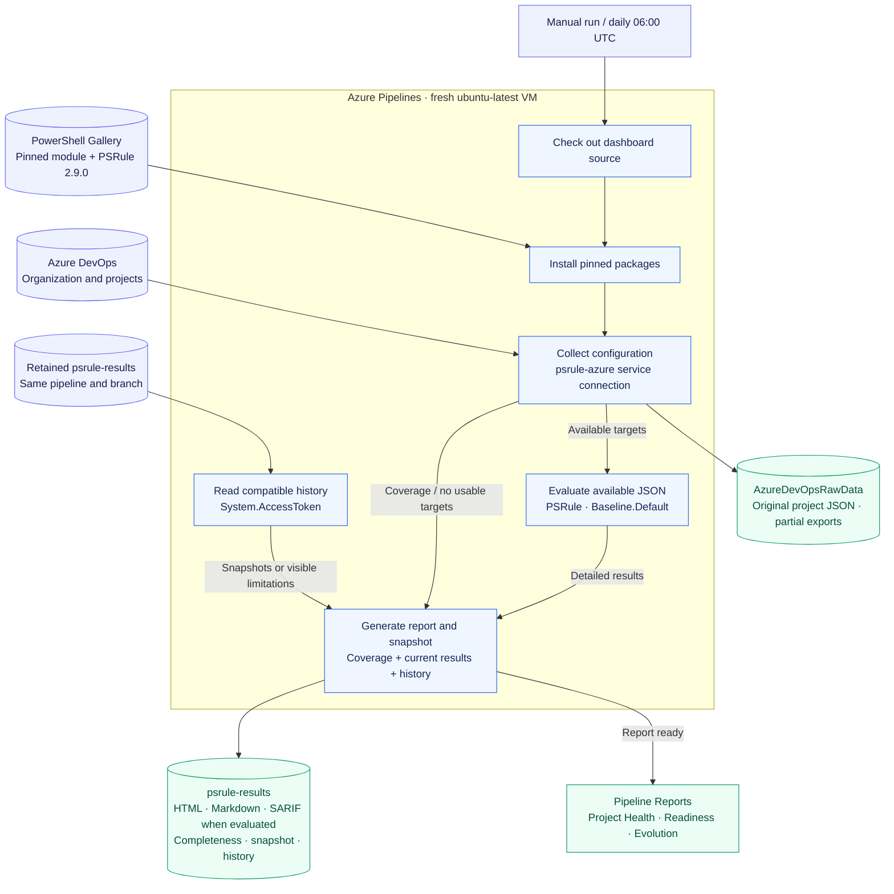

# Dashboard architecture

## Assessment pipeline

`azure-pipelines/run-assessment.yml` is the dashboard repository's only pipeline
entry point. It runs manually or daily at 06:00 UTC on `main`, with push and PR
triggers disabled. The Microsoft-hosted `Azure Pipelines` pool (`ubuntu-latest`) executes the job; `psrule-azure` supplies the Azure
DevOps token. Only dashboard source is checked out. The assessment task installs
`DevOpsTools.AzureDevOps.PSRule` 0.2.1 from PowerShell Gallery and imports that
exact version, with PSRule 2.9.0. The module repository is not accessed.

`Invoke-PSRuleAssessment.ps1` collects organization data, evaluates PSRule 2.9.0
with `Baseline.Default`, records configuration/module identity and completed
evaluation evidence, and invokes `Export-PSRulePipelineReport.ps1`. No Azure
resource deployment, Monitor ingestion, or Log Analytics query is part of the run.
The package version is pinned by `-ModuleVersion` in the YAML. Update the pin after
publishing a new module version. Installation and import failures remain red.

Each job receives a fresh Microsoft-hosted VM; no devcontainer listener is
required. Hosted capacity and pipeline authorization are managed in Azure DevOps.
The script resets its dedicated `raw-export` and `reports` staging directories
before each attempt, so reused agents cannot contribute stale results. Collection
status is outside the resource input directory. Available exports are evaluated
without the module's optional `-Strict` policy. Recorded collection errors become
escaped pipeline warnings; HTML and Markdown list affected projects, collectors,
statuses, and reason codes. Missing exports never create passing results. Totals
cover only available evaluated data.

Incomplete collection and absent assessment results finish as `SucceededWithIssues`
(yellow) after report generation. No inputs or zero results produce a diagnostic
dashboard with zero evaluated checkpoints and no compliance conclusion. SARIF is
retained only when evaluation produces results. Authentication, terminating export
errors, rule execution, report writing, and artifact publication failures remain
red. Rule violations remain findings, rather than infrastructure failures.

## Report interfaces

| Artifact | Contents |
| --- | --- |
| `AzureDevOpsRawData` | Original JSON exports, preserving project subfolders; partial data survives collection failure. |
| `psrule-results` | `collection-status.json`, persisted `assessment-snapshot.json` (schema 1.0), available `assessment-history.json`, and SARIF, HTML and Markdown when generated. |

Both artifact tasks use `succeededOrFailed()`. HTML publication also requires
`PSRuleReportReady=true`, set only after report generation. The installed BlakYaks
`PublishHtmlReport@1` task displays `Project Health & Compliance` on the run's Reports page.
The Markdown summary is attached with `task.uploadsummary`. HTML is self-contained
and can be downloaded and opened offline. Raw data and reports use pipeline
permissions and retention; retain runs when their evidence must be preserved.

## Project Health and historical evidence

The [three-tab report](project-health.md) uses `AssessmentModel.ps1` for persisted
schema 1.0 evidence and `ProjectHealthReport.ps1` for compact display schema 2.0.
Static HTML and embedded scripts/styles work offline. Organization discovery and
collector gaps remain visible in every tab and without JavaScript; zero results
show an explicit diagnostic instead of a compliance conclusion.

`Get-AssessmentHistory.ps1` reads retained `psrule-results` artifacts from the same
pipeline and branch, using the mapped `System.AccessToken`. History permission or
retention gaps are displayed as limitations. The runner hashes installed module
source/help and PSRule options; incompatible configuration/module identities or
incomplete evidence cannot establish improvement. Current assessment collection,
error and artifact behavior remains as documented above.

## Consolidation and legacy resources

The module repository publishes `DevOpsTools.AzureDevOps.PSRule` through
GitHub Actions to PowerShell Gallery. Assessment installs the published package
and does not depend on private source access. The weekly module assessment is
replaced by this daily assessment. The operational cutover completed on 2026-10-25;
see the validation and rollback record below.

Standalone Bicep and publishing scripts remain for existing installations. They
are outside the assessment execution path; existing Azure resources are not deleted.
The live classic definition may contain a newer Project Health source bundle than
`main`; preserve that reporter when updating it rather than replacing it with an
older template. The reviewed reporter is now included in the source-backed YAML flow.
`Invoke-PSRuleWorkbookAssessment.ps1` and its compressed task bundler remain
standalone legacy compatibility utilities; `run-assessment` never calls them.
Historical run IDs and their report artifacts remain unchanged.

## Hosted cutover verification — 2026-10-25

Definition **19**, `run-assessment`, is enabled and uses dashboard `main`.
Manual runs [141](https://dev.azure.com/ai-experiments/PSRule.Rules.AzureDevOps/_build/results?buildId=141)
and [142](https://dev.azure.com/ai-experiments/PSRule.Rules.AzureDevOps/_build/results?buildId=142)
validated commit `37d213c0923e9027cf6f7e3aca3e28833968e156` on the Microsoft-hosted
`Azure Pipelines` pool with `ubuntu-latest`. Both installed
`DevOpsTools.AzureDevOps.PSRule` **0.2.1** from PowerShell Gallery and evaluated
**546 checkpoints: 241 Pass, 305 Fail, zero execution errors**.

Both runs completed with issues because the organization billing collector remains
`Unavailable` / `EndpointUnavailable`. This accepted coverage gap stays visible;
it is not a passing control and does not establish a permissions diagnosis.
All other organization collectors completed. Billing investigation remains separate
from this cutover; no role, subscription, or hosted-capacity changes were made.

Report, raw-export and HTML publication tasks succeeded. The downloaded snapshots
and history agree with the run totals. The exact published HTML from each run
rendered and switched all three tabs without JavaScript errors. Run 142 retrieved
snapshots from runs **140 and 141**, confirming history across hosted runs. Its
retention limitation remains explicit; incomplete evidence cannot prove improvement.

The portal's Scheduled runs and trigger diagnostics confirmed:

- CI and PR triggers are disabled for `main`.
- The YAML schedule `0 6 * * *` is synchronized, with no UI schedule override.
- The next scheduled run is **2026-10-26 06:00 UTC**, repeating daily even without changes.
- No unsynchronized schedules or resource/build-completion triggers were reported.

The first naturally scheduled run remains to be observed. Manual runs validate the
execution path; the displayed next schedule verifies configuration, not a completed
automatic execution. See [Microsoft's schedule guidance](https://learn.microsoft.com/azure/devops/pipelines/process/scheduled-triggers).

After these checks, only `queueStatus` was changed for the legacy definitions:

| Definition | Before revision | After revision | Current state |
| --- | --- | --- | --- |
| 14 — legacy assessment | 4 | 5 | Disabled |
| 16 — workbook deployment | 6 | 7 | Disabled |
| 17 — classic assessment / workbook publishing | 17 | 18 | Disabled |
| 15 and 18 — setup utilities | Unchanged | Unchanged | Disabled |
| 19 — run-assessment | 3 | 3 | Enabled |

Re-reading the definitions confirmed unchanged process definitions (including the
classic embedded bundle), variables, repositories, triggers and queues. Existing
runs, artifacts and Azure resources were retained. For rollback, re-read the latest
revision and restore only the affected definition's `queueStatus` to `enabled`;
coordinate definition 19's state to avoid duplicate execution. Do not restore an
old full definition over newer edits or replace the classic bundle.

## Validation

Run `Invoke-Pester ./tests -Output Detailed`, `npm test` and `npm run test:browser`.
Assessment tests cover complete and
incomplete collection, raw file retention, repeat attempts, zero results, execution
errors, and rejection of Azure deployment/Monitor requests. Browser checks use
`node tests/PipelineReport.Browser.Tests.cjs` with Playwright Chromium and exercise
the report in an iframe. Verify live artifact and HTML task publication separately.
