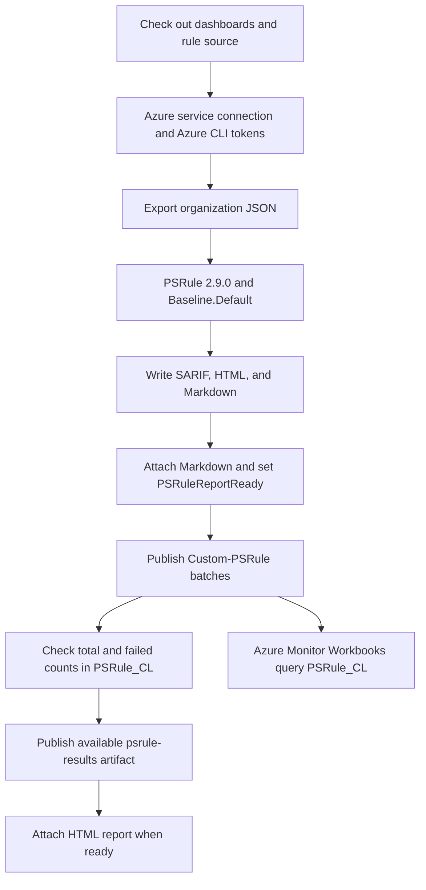

# Dashboard architecture

This document describes the repository sources.
It does not establish the current state of deployed Azure resources or remote branches.

## Components

| Component | Responsibility |
| --- | --- |
| `Invoke-PSRuleWorkbookAssessment.ps1` | Import the supplied rule module, collect inputs, evaluate rules, create reports, publish results, and check ingestion. |
| `Export-PSRulePipelineReport.ps1`, `ProjectHealthReport.ps1`, `AssessmentModel.ps1` and `src/templates/assessment.{js,css}` | Generate static essentials and the three-tab HTML display, Markdown summary, and normalized evidence snapshot. |
| `Get-AssessmentHistory.ps1` | Discover, validate and aggregate retained assessment artifacts; embed history in the main dashboard. |
| `New-ProjectHealthPipelineBundle.ps1` | Package the reporter and effort configuration into a compressed bootstrap for the existing classic pipeline task. |
| `Publish-PSRuleWorkbookResults.ps1` | Convert detailed results to the ingestion schema and send authenticated batches. |
| `Deploy-PSRuleWorkbooks.ps1` and `src/bicep/workbooks.bicep` | Deploy and inspect the workspace, result table, ingestion rule, and five workbooks. |
| `src/bicep/main.bicep` and older analysis scripts | Preserve the original deployment and shared-key Monitor path. This path is distinct from the manual workbook pipeline. |

## Manual assessment pipeline

`azure-pipelines/publish-workbooks.yml` disables push and PR triggers and uses the self-hosted `AI-Pool`.
It checks out dashboards under `s/dashboards` and rules under `s/rules`.
The rule repository resource selects `main` through the configured GitHub endpoint.
The Azure CLI task uses the `psrule-azure` service connection.

Artifact publication uses `succeededOrFailed()`, so it can execute after the assessment task fails.
HTML publication additionally requires `PSRuleReportReady` to equal `true`.
The assessment script sets this variable after report generation and before ingestion.
Expected rule failures remain visible in reports. Zero results stop report generation. Rule execution errors retain reports and block workbook ingestion.
Collection now writes a completeness report. Partial or unknown collection retains current-run reports and blocks workbook ingestion. See [assessment analytics](assessment-analytics.md) for the current reporting contract and history integration.

The `psrule-results` artifact contains `psrule-results.sarif`, `psrule-dashboard.html`, and `psrule-summary.md` when generation succeeds.
The script also attaches Markdown to the run summary.
`PublishHtmlReport@1` requires the HTML Reports extension and uses the HTML file as `reportDir`.
Open the run's **Reports** page and select the configured attachment name.
The repository YAML uses **DevOps Assessment Analytics**; the validated classic
definition **17** uses **Project Health & Compliance**. Its current validation
and operational handover are recorded in the [Project Health guide](project-health.md).
The **Code Coverage** page is a separate report surface. This pipeline contains no coverage publication task.

## Project Health report

The offline report contains Project Health, Compliance Readiness and Evolution.
PowerShell renders static essentials; JavaScript adds shared filters, a drawer,
sorting and conservative historical comparisons. All assets and data are inline,
with root-scoped styles and no runtime requests. Iframe rendering and static
markup injection are supported.

The HTML display projection is schema **2.0**, with one rule dictionary and compact
historical results. Persisted snapshots/history remain schema **1.0** and use the
existing pipeline artifact store. Missing coverage is never passing; only an
explicit later Pass can resolve an earlier failure when evidence is comparable.

`config/effort.json` supplies reviewed estimates independently of rule severity.
It ships unset. With no known estimate for failing controls in scope, the view
hides effort-dependent content and orders projects by measured findings. Partial
estimates retain Unknown and Needs estimate. See [definitions and configuration](project-health.md#definitions-and-configuration)
for ordering, thresholds and estimate provenance.

The existing classic definition embeds a ZIP/base64 source snapshot instead of
checking out this feature branch. Changing its rules source branch does not
replace the reporter. Report-only validation skips Monitor publishing; normal
ingestion remains a separate path. No devcontainer listener starts automatically:
the validated agent ran with `run.sh --once` and exited after each job. The
[startup plan](assessment-analytics.md#plan-build-agent-in-the-devcontainer) remains
future work.

## Azure result contract

`workbooks.bicep` creates a Log Analytics workspace, the `PSRule_CL` table, and a direct data collection rule.
The input stream is `Custom-PSRule`. Its data flow writes to `Custom-PSRule_CL`.

| Column | Meaning |
| --- | --- |
| `TimeGenerated` | UTC publication timestamp. |
| `RunId_s` | Organization name and pipeline build ID. |
| `RuleName_s`, `DisplayName_s` | Rule identifier and display name. |
| `TargetName_s`, `TargetType_s` | PSRule target identity and type. |
| `Outcome_s` | Rule outcome. |
| `Annotations_s` | JSON annotations from the rule information. |
| `Field_s` | JSON target fields, including structured identity metadata when available. |

The publisher requests an Azure Monitor bearer token and submits batches of at most 100 records.
It rejects a batch body larger than 900,000 bytes. It retries HTTP 429 and HTTP 5xx responses up to four times.
All records in one publisher invocation share a timestamp and run ID.

Assessment obtains a separate query token and checks total and failed counts for the run.
It makes up to 45 query attempts, with 20-second waits after unsuccessful attempts.
Excess records trigger a duplicate-record error. A timeout fails the assessment task.
This check does not roll back partial ingestion or prevent a repeated submission.

Five workbook modules supply the main view, resource state, rule summary, resources by rule, and rule hits by resource.
The template configures 30-day retention and public ingestion and query endpoints.
It does not define identity role assignments. Required ingestion and query access must exist outside this template.

## Other pipeline entry points

| Definition | Structure and dependency |
| --- | --- |
| `azure-pipelines/deploy-workbooks.yml` | Manual deployment on `AI-Pool` through `psrule-azure`. Validates and previews Bicep, creates deployment `psrule-workbooks`, and checks workbook content and table queries. |
| `azure-pipelines/azure-pipelines.yml` | Daily 06:00 UTC schedule on `main`, hosted Ubuntu agent, one `Run` stage. Uses `devops-assessment-vg001`, an Azure Artifacts module, and the older Monitor analysis script. Publishes raw and analysis artifacts from the export directory. |

The manual assessment reads outputs from deployment `psrule-workbooks`.
These outputs supply the workspace ID, ingestion endpoint, and immutable rule ID.
The YAML files do not chain deployment and assessment automatically.

## Operation and validation

Protect artifacts and workspace results because they contain organization and target identities.
Restrict service-connection and variable-group access. Raw exports in the older pipeline require additional care.
Pipeline retention controls snapshots. Log Analytics retention controls historical records.

Run offline dashboard tests with `Invoke-Pester ./tests -Output Detailed` from this repository.
Browser checks use `tests/PipelineReport.Browser.Tests.cjs` and Playwright Chromium.
They exercise iframe rendering. They do not establish extension installation or live workspace permissions.

The [module architecture](../../PSRule.Rules.AzureDevOps/docs/architecture.md) contains the complete pipeline inventory, module boundaries, risks, and decision records.
That link assumes the two repositories retain their current workspace directory names.

### Source entry points

- [Manual assessment pipeline](../azure-pipelines/publish-workbooks.yml) and [assessment script](../src/scripts/Invoke-PSRuleWorkbookAssessment.ps1).
- [Report generator](../src/scripts/Export-PSRulePipelineReport.ps1) and [ingestion publisher](../src/scripts/Publish-PSRuleWorkbookResults.ps1).
- [Deployment pipeline](../azure-pipelines/deploy-workbooks.yml), [deployment script](../src/scripts/Deploy-PSRuleWorkbooks.ps1), and [workbook infrastructure](../src/bicep/workbooks.bicep).
- [Legacy daily pipeline](../azure-pipelines/azure-pipelines.yml) and [legacy infrastructure](../src/bicep/main.bicep).
